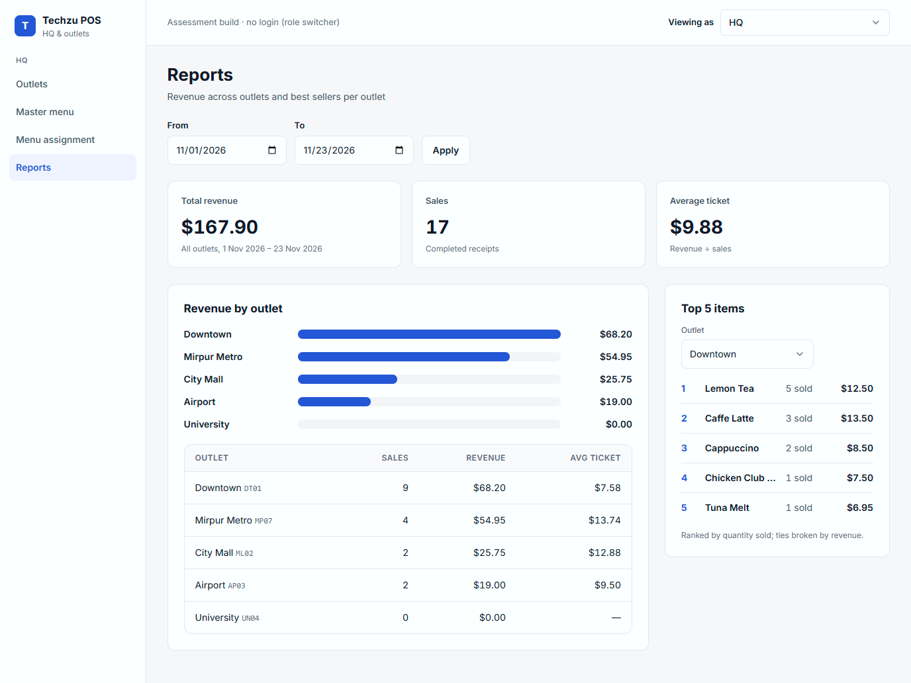

# Techzu POS

A central HQ system for a multi-outlet food & beverage business. HQ manages the master menu,
assigns items to outlets with optional per-outlet prices and sees sales reports. Each outlet sells
from its own menu, keeps its own stock and issues its own sequential receipt numbers.

**Live demo:** https://techzu-pos.onrender.com<br>
**API reference (interactive):** https://techzu-pos.onrender.com/api/docs

> Hosted on Render's free tier: the service sleeps after about 15 minutes without traffic, so the
> first request after a pause can take up to a minute. After that it responds in well under a second.


*HQ → Reports: revenue, sale count and average ticket per outlet, with the top 5 items for the selected outlet.*

## Assessment deliverables

Where to find each item from the brief's "Required Deliverables":

| # | Deliverable | Where |
| --- | --- | --- |
| 1 | Deployed instance for end users | [techzu-pos.onrender.com](https://techzu-pos.onrender.com) · [API reference](https://techzu-pos.onrender.com/api/docs) |
| 2 | GitHub repository | This repo, release [`v1.0.0`](https://github.com/naieem-bd/techzu-pos/releases/tag/v1.0.0) |
| 2.1 | Proper folder structure | [Architecture](#architecture) (layers) · `server/`, `client/`, `docs/` |
| 2.2 | Clean commits | One squash-merged [pull request](https://github.com/naieem-bd/techzu-pos/pulls?q=is%3Apr+is%3Aclosed) per feature, Conventional Commits |
| 2.3.1 | README: setup instructions | [Quick start](#quick-start) · [Configuration](#configuration) |
| 2.3.2 | README: API endpoints | [API](#api) · [interactive docs](https://techzu-pos.onrender.com/api/docs) · [`docs/openapi.yaml`](docs/openapi.yaml) |
| 2.3.3 | README: schema explanation | [Database schema](#database-schema) |
| 2.3.4 | README: architecture explanation | [Architecture](#architecture) · [Concurrency and data integrity](#concurrency-and-data-integrity) |
| 2.3.5 | README: scaling strategy | [Scaling strategy](#scaling-strategy) |
| 3 | Architecture documentation | [docs/ARCHITECTURE.md](docs/ARCHITECTURE.md) |
| 3.1 | ERD diagram (schema and relationships) | [ERD](docs/ARCHITECTURE.md#2-data-model-and-erd) |
| 3.2 | Scaling plan: 10 outlets, 100,000 transactions/month | [Scaling plan](docs/ARCHITECTURE.md#5-scaling-plan-10-outlets-100000-transactions-per-month): [database](docs/ARCHITECTURE.md#database-scaling) · [reporting](docs/ARCHITECTURE.md#reporting-performance) · [infrastructure](docs/ARCHITECTURE.md#infrastructure) · [architectural evolution](docs/ARCHITECTURE.md#architectural-evolution) |
| 4 | Conversion to microservices | [Evolving into microservices](docs/ARCHITECTURE.md#6-evolving-into-microservices) |
| 5 | Offline POS mode strategy | [Offline POS and POS–KDS](docs/ARCHITECTURE.md#7-offline-pos-mode-and-poskds-communication) |
| 5.1 | Syncing sales to HQ on reconnect | [Syncing when the internet returns](docs/ARCHITECTURE.md#syncing-when-the-internet-returns) |
| 5.2 | POS and KDS working together offline | [POS and KDS during an outage](docs/ARCHITECTURE.md#pos-and-kds-during-an-outage) |

**Contents:** [Features](#features) · [Tech stack](#tech-stack) · [Quick start](#quick-start) ·
[Configuration](#configuration) · [API](#api) · [Database schema](#database-schema) ·
[Architecture](#architecture) · [Concurrency and data integrity](#concurrency-and-data-integrity) ·
[Testing](#testing) · [Deployment](#deployment) · [Scaling strategy](#scaling-strategy) ·
[Assumptions and trade-offs](#assumptions-and-trade-offs) · [Future improvements](#future-improvements)

Full design notes, the ERD, the scaling plan, the microservices path and the offline POS strategy
are in **[docs/ARCHITECTURE.md](docs/ARCHITECTURE.md)**.

---

## Features

**HQ**
- Create outlets and master menu items (SKU, category, base price, active flag)
- Assign items to outlets, override the price per outlet, mark items unavailable at an outlet
- Reports: revenue per outlet (with sale count and average ticket) and the top 5 items per outlet,
  for any date range

**Outlet**
- POS screen: sells only items HQ assigned to that outlet, at the outlet's effective price
- Multi-item sales that deduct stock and issue a sequential receipt number (e.g. `DT01-000042`)
- Inventory per outlet with low/out-of-stock status and stock adjustments
- Sales history with date and receipt filters

**Guarantees**
- Stock can never go negative, even under concurrent sales
- Receipt numbers are sequential per outlet with no gaps or duplicates, even under concurrent sales
- Every sale is one database transaction: all of it is saved, or none of it

The UI has a **"Viewing as"** switcher (HQ or a specific outlet) in place of login; authentication
was out of scope for this assessment.

---

## Tech stack

| Layer | Technology |
| --- | --- |
| Backend | Node.js 22, Express 4, TypeScript (strict) |
| Database | PostgreSQL 16 via `pg` with raw, parameterized SQL (no ORM) |
| Validation | Zod (request params, query, body and environment config) |
| Frontend | React, Vite, TypeScript, TanStack Query, React Router, React Hook Form, Tailwind CSS, shadcn/ui |
| API docs | OpenAPI 3.1 + Scalar (`/api/docs`) |
| Testing | Jest, Supertest, against a real PostgreSQL |
| Packaging | One multi-stage Docker image serving the API and the built React app |
| Hosting | Render (web service) + Neon (managed PostgreSQL), Singapore region |

---

## Quick start

### Option A: Docker only (fastest)

Requires Docker.

```bash
git clone https://github.com/naieem-bd/techzu-pos.git
cd techzu-pos
cp .env.example .env
docker compose up --build
```

Open **http://localhost:3000**. On start the container runs the database migrations and loads
demo data (outlets, menu items, assignments and stock). The API reference is at
http://localhost:3000/api/docs.

### Option B: Local development

Requires Node.js 22 and Docker (for PostgreSQL).

```bash
cp .env.example .env
docker compose up -d db db_test   # PostgreSQL for development and for tests
npm install
npm run db:migrate
npm run db:seed
npm run dev                       # API on :3000, React app on :5173
```

Open **http://localhost:5173**. Vite proxies `/api` to the server.

### Useful scripts

| Command | What it does |
| --- | --- |
| `npm run dev` | API and React app together, with reload |
| `npm test` | Full test suite (needs `db_test` running) |
| `npm run test:concurrency` | The concurrency suite only, with a summary per scenario |
| `npm run lint` / `npm run typecheck` | ESLint / TypeScript checks for both workspaces |
| `npm run build` | Production build of server and client |
| `npm run db:migrate` / `db:seed` / `db:reset` | Apply migrations / load demo data / rebuild the dev database (refuses in production) |

---

## Configuration

All settings come from environment variables, validated at startup; the app refuses to start with a
clear list of anything missing or invalid. See [`.env.example`](.env.example).

| Variable | Default | Purpose |
| --- | --- | --- |
| `DATABASE_URL` | (required) | PostgreSQL connection string |
| `DB_SSL` | `false` | `true` for hosted PostgreSQL: verifies the certificate and hostname, uses channel binding |
| `DB_POOL_MAX` | `10` | Maximum database connections per instance |
| `PORT` | `3000` | HTTP port (set automatically on Render) |
| `CORS_ORIGIN` | (required locally) | Allowed origin(s), comma-separated; defaults to `RENDER_EXTERNAL_URL` on Render |
| `NODE_ENV` | `development` | `production` hides error details from responses |
| `LOG_LEVEL` | `info` | pino log level |
| `SEED_ON_START` | `false` | Load the idempotent demo data when the production image starts |
| `TEST_DATABASE_URL` | compose `db_test` | Database used by the test suite |
| `POSTGRES_*`, `DB_PORT`, `TEST_DB_PORT`, `APP_PORT` | see file | Used by `docker-compose.yml` |

---

## API

Base path `/api`. The complete, interactive reference with request and response examples is at
**[/api/docs](https://techzu-pos.onrender.com/api/docs)** (spec: [`docs/openapi.yaml`](docs/openapi.yaml),
also served at `/api/openapi.json` for Postman import).

| Method | Path | Purpose |
| --- | --- | --- |
| GET | `/api/health` | Liveness and database check |
| GET, POST | `/api/outlets` | List (search, pagination) / create an outlet |
| GET, POST | `/api/menu-items` | List (search, category, active, pagination) / create a master item |
| PATCH | `/api/menu-items/:id` | Update name, category, base price, active flag (SKU is immutable) |
| GET | `/api/outlets/:outletId/menu-items` | Every master item with its assignment, override and effective price for this outlet |
| POST | `/api/outlets/:outletId/menu-items` | Assign an item (optional price override); creates its stock row |
| PATCH | `/api/outlets/:outletId/menu-items/:menuItemId` | Change price override (`null` clears it) or availability |
| DELETE | `/api/outlets/:outletId/menu-items/:menuItemId` | Unassign (refused with 409 once the item has sales) |
| GET | `/api/outlets/:outletId/menu` | What the POS can sell: assigned, available and active items with price and stock |
| GET | `/api/outlets/:outletId/inventory` | Stock per item with status (`in_stock`, `low`, `out`) |
| PATCH | `/api/outlets/:outletId/inventory/:menuItemId` | Adjust stock by a signed amount (never below 0) |
| POST | `/api/outlets/:outletId/sales` | Create a multi-item sale |
| GET | `/api/outlets/:outletId/sales` | Sales history (date range, receipt number, pagination) |
| GET | `/api/outlets/:outletId/sales/:saleId` | One receipt with its lines |
| GET | `/api/reports/revenue-by-outlet` | Revenue, sale count and average ticket per outlet |
| GET | `/api/reports/outlets/:outletId/top-items` | Best-selling items for an outlet (default top 5) |

### Conventions

- Success: `{ "data": … }`; lists add `"meta": { "total", "limit", "offset" }`.
- Errors: `{ "error": { "code", "message", "details" } }` with stable codes and status codes
  (404 not found, 409 conflict, 422 validation or business rule).
- Money is always a decimal **string** (`"4.50"`), in requests and responses.
- Date filters take ISO 8601 datetimes with a timezone; `from` is inclusive, `to` is exclusive.
- Unknown fields in a request are rejected.

### Example: create a sale

```http
POST /api/outlets/1/sales
Content-Type: application/json

{ "items": [ { "menuItemId": 2, "quantity": 2 }, { "menuItemId": 7, "quantity": 1 } ] }
```

```json
{
  "data": {
    "id": 42,
    "outletId": 1,
    "receiptNumber": 42,
    "receiptNo": "DT01-000042",
    "totalAmount": "12.00",
    "createdAt": "2026-11-23T05:10:00.000Z",
    "items": [
      { "menuItemId": 2, "sku": "COF-LAT", "name": "Caffe Latte", "quantity": 2, "unitPrice": "4.50", "lineTotal": "9.00" },
      { "menuItemId": 7, "sku": "BAK-CRO", "name": "Croissant", "quantity": 1, "unitPrice": "3.00", "lineTotal": "3.00" }
    ]
  }
}
```

Not enough stock for any line rejects the whole sale and changes nothing:

```json
{
  "error": {
    "code": "INSUFFICIENT_STOCK",
    "message": "Not enough stock for menu item 2: requested 999, available 60",
    "details": { "menuItemId": 2, "requested": 999, "available": 60 }
  }
}
```

---

## Database schema

Seven tables. The full ERD and the reasoning behind each constraint and index are in
[docs/ARCHITECTURE.md](docs/ARCHITECTURE.md#2-data-model-and-erd).

| Table | Holds | Key rules |
| --- | --- | --- |
| `outlets` | Outlets | Unique `code` (used as the receipt prefix) |
| `menu_items` | HQ master menu | Unique, immutable `sku`; `base_price >= 0` |
| `outlet_menu_items` | Which items each outlet sells | One row per outlet and item; optional `price_override`; `is_available` |
| `inventory` | Stock per outlet and item | `quantity >= 0`; can only exist for assigned items (composite foreign key) |
| `receipt_counters` | Last receipt number per outlet | One row per outlet; locked while a sale takes its number |
| `sales` | Receipt headers | Unique `(outlet_id, receipt_number)`; total in `NUMERIC(12,2)` |
| `sale_items` | Receipt lines | Price copied at sale time; `line_total = unit_price × quantity` enforced |

Effective price at an outlet = `price_override` if set, otherwise `base_price`. Prices are copied onto
each sale line, so later price changes never alter past receipts.

---

## Architecture

```text
React SPA ──HTTPS/JSON──> Express API ──parameterized SQL──> PostgreSQL
            (same origin, one Docker image)
```

The backend is layered, and each layer has one job:

| Layer | Responsibility |
| --- | --- |
| `routes/` | URL and middleware wiring only |
| `middlewares/` | Zod validation, rate limiting, logging, central error handling |
| `controllers/` | Read validated input, call one service, shape the HTTP response |
| `services/` | Business rules and transactions |
| `repositories/` | SQL only; every function receives the database client, so one transaction can span several repositories |

Also in place: Zod-validated config that fails fast, `helmet` security headers, CORS limited to
configured origins, a 100 kB body limit, rate limiting on `/api`, structured logs with request IDs,
graceful shutdown, and a health check that verifies the database.

---

## Concurrency and data integrity

A sale runs in a single transaction:

1. Merge duplicate lines and sort them by item id.
2. Load every item's effective price in one query; reject items that aren't assigned, available or active (422).
3. For each line, in that sorted order: `UPDATE inventory SET quantity = quantity - q WHERE … AND quantity >= q`.
   If no row is updated, the sale fails with 409 and everything rolls back.
4. Increment the outlet's receipt counter **last**.
5. Insert the receipt and all of its lines, with the total calculated in SQL.

| Guarantee | How |
| --- | --- |
| No negative stock | The stock check and the deduction are the same statement; PostgreSQL re-checks it after waiting for the row lock. `CHECK (quantity >= 0)` is the final guard. |
| No deadlocks | Every sale locks stock rows in the same order (by item id). |
| Sequential receipts per outlet | The counter row is locked until commit, so concurrent sales in one outlet get numbers one after another; other outlets are unaffected. |
| No gaps | A failed sale rolls back its counter increment. `UNIQUE (outlet_id, receipt_number)` is the final guard. |
| Exact money | `NUMERIC(12,2)` in the database, decimal strings in the API, integer cents in the browser. |

### Proven by the concurrency suite (`npm run test:concurrency`)

| Scenario | Result |
| --- | --- |
| 50 concurrent buyers for 30 units of one item | Exactly 30 sales succeed, 20 get 409; receipts are exactly 1–30; final stock 0 |
| 20 concurrent sales split across 2 outlets | Each outlet's receipts are exactly 1–10 |
| 20 concurrent sales with items in opposite orders (`[A,B]` / `[B,A]`) | All succeed, no deadlock, exact stock totals |
| Concurrent sales where half include an unassigned item | Rejected sales consume no receipt number and no stock |

---

## Testing

```bash
docker compose up -d db_test
npm test                  # unit + integration tests against a real PostgreSQL
npm run test:concurrency  # the concurrency scenarios above
```

The suite covers every endpoint (success, validation, 404, 409 and 422 cases), database constraints,
migrations, transaction rollback, money handling, configuration and TLS settings, the SPA fallback,
and the API documentation itself: tests fail if a route is undocumented, an error code is missing
from the spec, or a request example would fail the real validators.

---

## Deployment

One Docker image serves the API and the React build.

- **Image:** multi-stage build on `node:22-alpine`; production dependencies only; runs as the
  non-root `node` user; Docker `HEALTHCHECK` on `/api/health`.
- **Start-up:** migrations (guarded by an advisory lock), then the idempotent demo seed when
  `SEED_ON_START=true`, then the server.
- **Render:** [`render.yaml`](render.yaml) defines a free Docker web service in Singapore, deployed
  from `main`. `DATABASE_URL` is entered in the Render dashboard as a secret.
- **Neon:** managed PostgreSQL 16 in Singapore, using the direct (non-pooled) connection string
  with `DB_SSL=true`.

---

## Scaling strategy

For **10 outlets and 100,000 transactions per month** (about 3,300 sales a day, roughly 1–3 per second
at peak), a single well-indexed PostgreSQL is comfortably enough. The plan focuses on keeping it fast
as history grows and protecting the sale path:

- **Database:** connection pooling (PgBouncer), monthly partitioning of `sales` and `sale_items`,
  archiving old partitions, a read replica for reports, point-in-time recovery.
- **Reporting:** pre-aggregated daily summary tables (or materialized views) on the replica, instead of
  scanning raw sales.
- **Infrastructure:** stateless API containers behind a load balancer, managed PostgreSQL, Redis for
  menu caching, CI/CD, centralised logs, metrics and alerts.
- **Architecture:** modular monolith now, then a transactional outbox with events, then services only
  where load or team size justifies them.

Details, plus the microservices design and the offline POS / kitchen display strategy, are in
**[docs/ARCHITECTURE.md](docs/ARCHITECTURE.md)**.

---

## Assumptions and trade-offs

- **No authentication**; the "Viewing as" switcher stands in for HQ and outlet users.
- **Stock is counted per menu item**; recipes and ingredient-level stock are out of scope.
- **Single currency**, stored as `NUMERIC(12,2)`, shown with two decimals.
- **Low-stock threshold** is a fixed value (5).
- **Raw SQL instead of an ORM** keeps transactions, locking and constraints explicit and reviewable.
- **The API docs are public** in every environment, which suits an unauthenticated demo.
- **Free hosting tiers:** the web service sleeps when idle (slow first request).

## Future improvements

- Authentication with role- and outlet-scoped access (JWT, RBAC)
- Outlet list columns for assigned-item count and last receipt; "assigned to x of N outlets" on the master menu
- Offline POS mode with idempotent sync, and a kitchen display integration (designed in ARCHITECTURE.md)
- Daily summary tables for reports, CSV export
- Per-item low-stock thresholds and stock movement history
- Frontend component and end-to-end tests
- CI pipeline running lint, type-check and both test suites on every pull request
