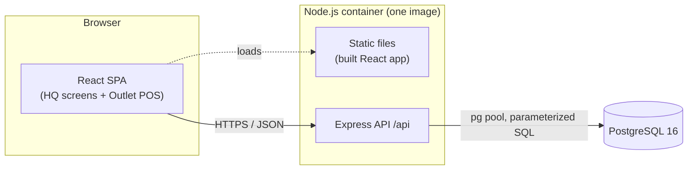
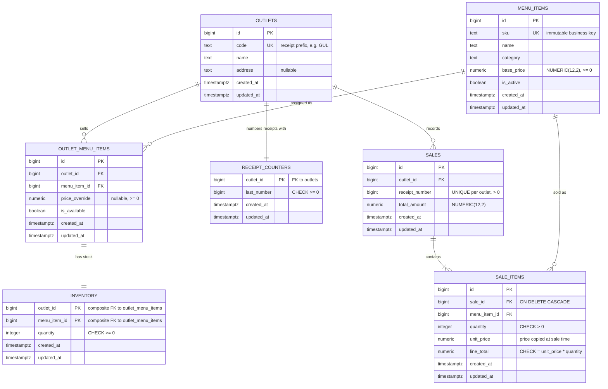
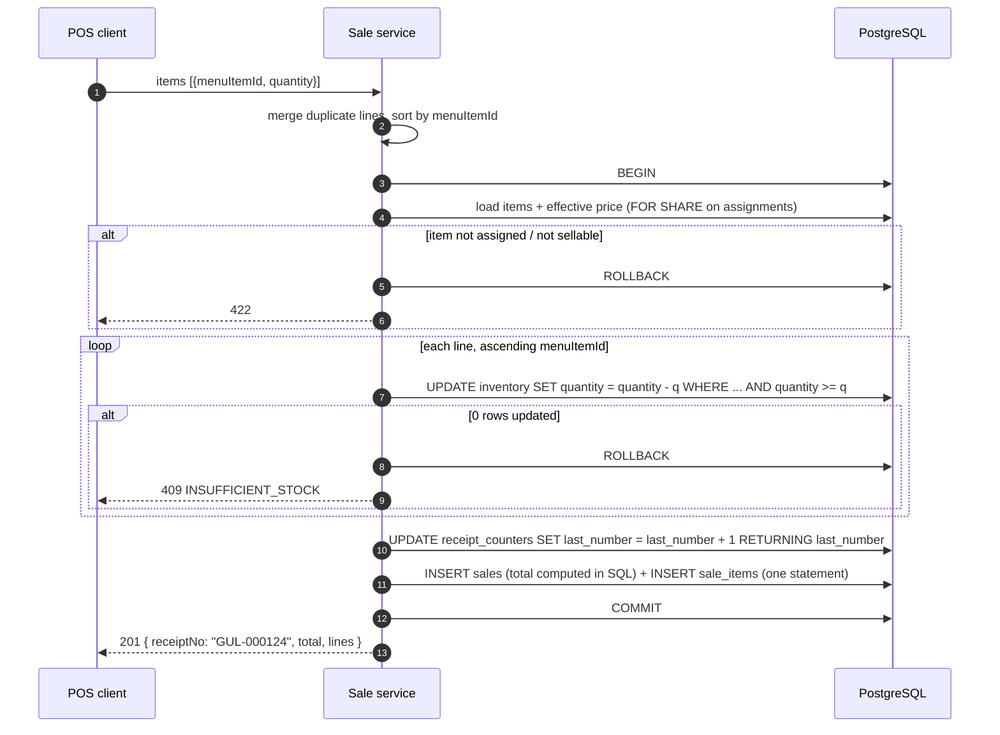
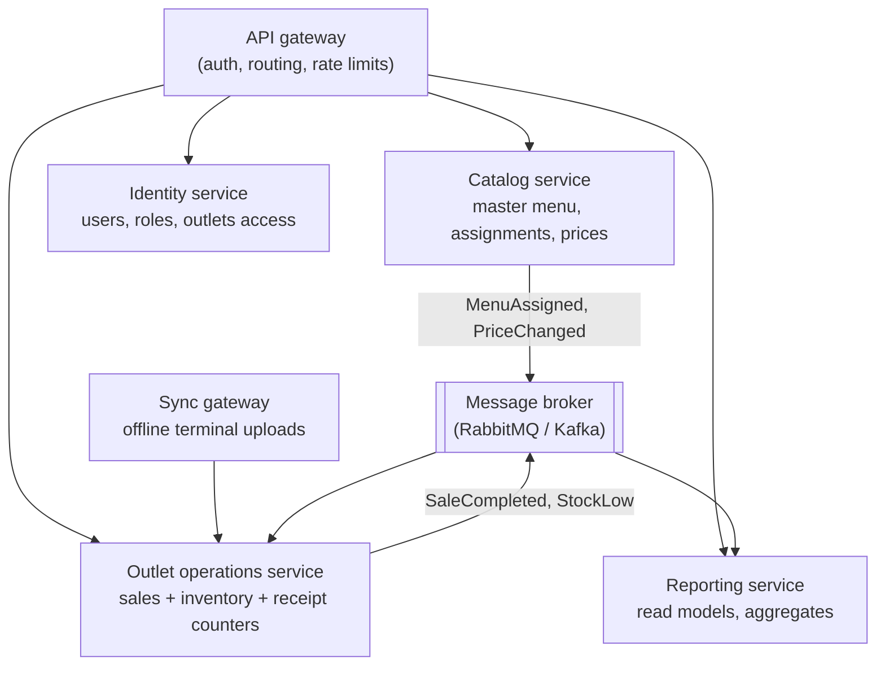
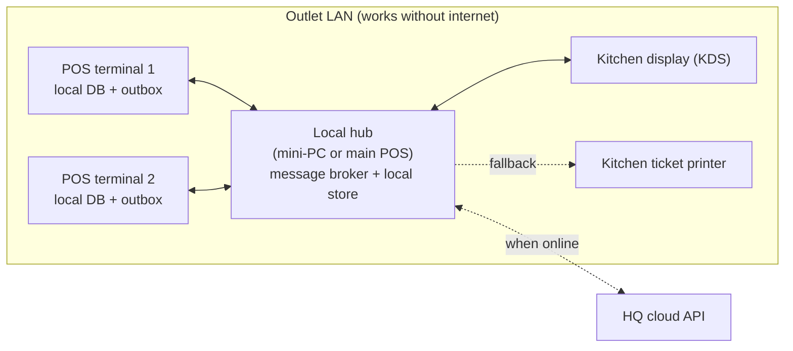
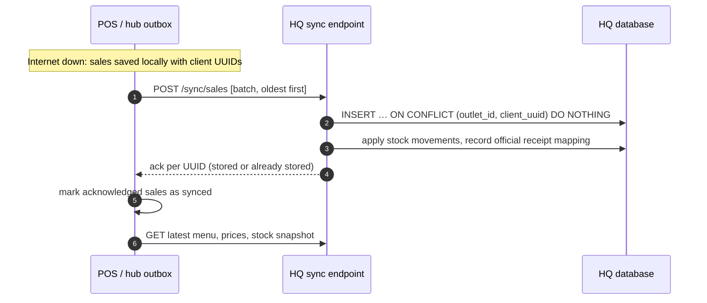

# Architecture

Techzu POS is a central HQ system for a multi-outlet food & beverage business. HQ owns the master
menu, decides which items each outlet sells (with optional per-outlet prices) and sees sales
reports. Each outlet sells from its own menu and keeps its own stock.

This document covers:

1. [System overview](#1-system-overview)
2. [Data model and ERD](#2-data-model-and-erd)
3. [The sale transaction and concurrency guarantees](#3-the-sale-transaction-and-concurrency-guarantees)
4. [API conventions](#4-api-conventions)
5. [Scaling plan: 10 outlets, 100,000 transactions per month](#5-scaling-plan-10-outlets-100000-transactions-per-month)
6. [Evolving into microservices](#6-evolving-into-microservices)
7. [Offline POS mode and POS–KDS communication](#7-offline-pos-mode-and-poskds-communication)
8. [Assumptions and trade-offs](#8-assumptions-and-trade-offs)

---

## 1. System overview



One Docker image serves both the React build and the REST API, so there is one URL, no CORS in
production and one thing to deploy. PostgreSQL is the single source of truth.

### Layered backend

```text
HTTP request
  → routes/        URL + middleware wiring only
  → middlewares/   validate (Zod), rate limit, request logging
  → controllers/   read validated input, call ONE service, shape the HTTP response
  → services/      business rules and transactions (withTransaction)
  → repositories/  SQL only; every function receives a Queryable (pool or transaction client)
  → PostgreSQL
errors → one central errorHandler → { "error": { "code", "message", "details" } }
```

Why this split:

- **Repositories take the database client as their first argument.** A service can run several
  repository calls inside one transaction by passing the same client to each, which is how the
  sale stays atomic across inventory, receipt counter and sales tables.
- **Services never see `req`/`res`.** Business rules are testable without HTTP and reusable from
  other entry points (a job, a sync endpoint).
- **Controllers never see SQL.** Swapping storage or adding caching does not touch HTTP code.

Cross-cutting pieces: Zod-validated environment config (fails fast at startup), `helmet`, CORS
restricted to configured origins, a 100 kB JSON body limit, rate limiting on `/api`, pino
structured logs with request IDs, graceful shutdown, and a `/api/health` endpoint that checks the
database.

---

## 2. Data model and ERD



### Key design decisions

| Decision | Why |
| --- | --- |
| `outlet_menu_items` joins outlets and the master menu, with `UNIQUE (outlet_id, menu_item_id)` | One row per assignment; holds the outlet-specific price override and availability. |
| **Effective price** = `COALESCE(price_override, base_price)` | Outlets inherit HQ's price unless HQ overrides it for that outlet. |
| `inventory` has a **composite FK** to `outlet_menu_items (outlet_id, menu_item_id)` | An outlet can only hold stock for items HQ assigned to it. Enforced by the database, not just code. |
| `CHECK (quantity >= 0)` on `inventory` | Negative stock is impossible even if application code had a bug. |
| `receipt_counters`: one row per outlet | Gives each outlet its own sequence that can be row-locked; see section 3. |
| `UNIQUE (outlet_id, receipt_number)` on `sales` | A receipt number can never be issued twice in an outlet. |
| `unit_price` and `line_total` copied onto `sale_items` | Old receipts never change when HQ edits prices later. |
| `NUMERIC(12,2)` for money, returned to clients as strings | Exact decimal arithmetic; no floating-point rounding anywhere. |
| `ON DELETE RESTRICT` everywhere except `sale_items → sales` | History cannot be deleted by accident; a sale's lines belong to the sale. |
| `updated_at` maintained by triggers | Correct even if a query forgets to set it. |

### Indexes

| Index | Serves |
| --- | --- |
| `outlet_menu_items_outlet_item_key (outlet_id, menu_item_id)` | Outlet menu, assignment lookups, the sale's item query |
| `outlet_menu_items_menu_item_id_idx (menu_item_id)` | "Which outlets sell this item?" and FK checks |
| `inventory_pkey (outlet_id, menu_item_id)` | Stock deduction during a sale, inventory listing per outlet |
| `sales_outlet_id_created_at_idx (outlet_id, created_at DESC)` | Sales history (newest first) and date-range reports per outlet |
| `sales_created_at_idx (created_at)` | Cross-outlet reports over a date range |
| `sales_outlet_receipt_number_key (outlet_id, receipt_number)` | Receipt lookup and the uniqueness guarantee |
| `sale_items_sale_menu_item_key (sale_id, menu_item_id)` | Loading a page of receipts' lines in one query |
| `sale_items_menu_item_id_idx (menu_item_id)` | Top-selling items report |

---

## 3. The sale transaction and concurrency guarantees

`POST /api/outlets/:outletId/sales` runs entirely inside one database transaction:



| Guarantee | How it is achieved |
| --- | --- |
| **Stock never goes negative** | The check and the deduction are one statement: `UPDATE … WHERE quantity >= $q`. When two sales compete for the same row, Postgres makes the second wait for the first, then re-evaluates the condition against the committed value. There is no read-then-write window. `CHECK (quantity >= 0)` is the final guard. |
| **All-or-nothing sales** | Every step shares one transaction; any error rolls back every stock deduction and the counter increment. |
| **No deadlocks** | Lines are merged and sorted by `menu_item_id`, so every sale locks inventory rows in the same order. Two sales can wait for each other but never hold what the other needs. |
| **Sequential receipt numbers per outlet** | The counter `UPDATE` row-locks the outlet's counter until commit, so concurrent sales in one outlet receive numbers one after another. Other outlets have their own row and are unaffected. |
| **No gaps** | A failed sale rolls back its increment, and failures before the counter step never touch it. |
| **Short lock time** | The counter is incremented **last**, after every check that can fail, so the lock that all sales of an outlet queue on is held only for the final inserts and commit. |
| **Consistent pricing** | Assignment rows are read `FOR SHARE`, so a concurrent price change or unassignment of the same item waits for the sale to finish. |

Why not `SELECT MAX(receipt_number) + 1`? Two concurrent transactions can read the same maximum and
issue the same number; one then fails on the unique constraint. A locked counter row serialises
numbering instead of failing.

**Proof:** `npm run test:concurrency` fires parallel requests at a running server: 50 buyers for 30
units (exactly 30 succeed, receipts 1..30, stock 0), two outlets in parallel (independent 1..N
sequences), opposite item orders (no deadlock), and rejected sales (no receipt number or stock
consumed).

---

## 4. API conventions

- Base path `/api`; resources are nested under the outlet they belong to
  (`/api/outlets/:outletId/menu`, `/inventory`, `/sales`).
- Success: `{ "data": … }`, lists add `"meta": { "total", "limit", "offset" }`.
- Errors: `{ "error": { "code": "INSUFFICIENT_STOCK", "message": "…", "details": { … } } }` with
  machine-readable codes and correct status codes (201, 404, 409, 422).
- Input is validated with strict Zod schemas: unknown fields are rejected.
- Money is sent and returned as decimal strings (`"250.00"`), never JSON numbers.
- PostgreSQL errors are mapped centrally (unique → 409, foreign key → 422, check → 409, numeric
  overflow → 422); production responses never include stack traces or SQL.

---

## 5. Scaling plan: 10 outlets, 100,000 transactions per month

### The numbers first

| Metric | Estimate |
| --- | --- |
| Sales per month | 100,000 |
| Sales per day | ≈ 3,300 |
| Average rate | ≈ 0.04 sales/second |
| Peak (lunch rush, ~10× average, concentrated in a few hours) | ≈ 1–3 sales/second |
| `sale_items` rows (≈ 3 lines per sale) | ≈ 300,000/month, ≈ 3.6 million/year |
| Data growth (rows + indexes, rough) | ≈ 1 GB/year |

A single well-indexed PostgreSQL instance handles this load comfortably; the current design would
run it as is. The plan is therefore about **staying fast as history accumulates, protecting the
sale path from reporting load, and operating safely**, not about re-architecting.

### Database scaling

1. **Connection pooling:** PgBouncer (transaction mode) in front of Postgres once there are several
   API instances, so total connections stay well under the server's limit. The app's pool is
   already configurable (`DB_POOL_MAX`).
2. **Partition `sales` and `sale_items` by month** (declarative range partitioning on
   `created_at`). Recent partitions stay small and hot in memory; queries with a date range touch
   only the partitions they need.
3. **Archive old partitions** (for example older than 13 months) to cheaper storage; dropping or
   detaching a partition is instant compared with large `DELETE`s.
4. **Read replica** for reports and history screens, so heavy reads never compete with sale
   transactions on the primary.
5. **Backups and recovery:** daily snapshots plus point-in-time recovery (WAL archiving) on a
   managed Postgres; restore tested regularly.
6. **Watch the hot spot:** the per-outlet receipt counter serialises sales *within* one outlet.
   At a few sales per second per outlet this is far from a limit; it would only matter at hundreds
   per second in a single outlet, where numbers could be allocated in blocks per terminal.

### Reporting performance

- **Summary tables instead of scanning raw sales.** A `daily_outlet_item_sales` table
  (outlet, item, date, quantity, revenue), updated in the same transaction as each sale or by a job
  every few minutes. Revenue-by-outlet and top-items reports read a few thousand summary rows
  instead of millions of line rows.
- Alternatively, **materialized views** refreshed concurrently on a schedule.
- Reports run on the **read replica** with composite indexes matching their filters
  (`outlet_id, date`).
- Cache report responses for short periods (e.g. 60 seconds) since HQ dashboards tolerate slightly
  stale data.

### Infrastructure

- **Stateless API containers** behind a load balancer, scaled horizontally (2+ instances for
  availability). Sessions or state never live in the process.
- **Managed PostgreSQL** with automated backups, monitoring and failover.
- **Redis** for caching outlet menus (read on every POS screen, changed rarely); invalidated when HQ
  edits a menu or assignment.
- **CI/CD:** lint, type-check, tests and the concurrency suite on every pull request; automatic
  deploys from `main` with database migrations run before the new version takes traffic.
- **Observability:** centralised structured logs (already JSON via pino with request IDs), metrics
  and alerts on p95 latency, error rate, failed sales (409/5xx), lock wait time and connection
  pool saturation.

### Architectural evolution

1. **Now:** modular monolith with clear layers and module boundaries (outlets, menu, inventory,
   sales, reports).
2. **Next:** a **transactional outbox**. Each sale also writes a `SaleCompleted` event row in the
   same transaction; a relay publishes it to a message broker. Summary tables, notifications and
   integrations consume events instead of querying sales directly.
3. **Later, only when load or team size justifies it:** extract services along those module
   boundaries (section 6).

---

## 6. Evolving into microservices

The system splits naturally along its business capabilities. The guiding rule: **keep anything that
must change in one ACID transaction inside one service.**



| Service | Owns | Why separate |
| --- | --- | --- |
| **Catalog** | Master menu, outlet assignments, price overrides | Written rarely by HQ, read constantly by every POS: scale and cache it independently. |
| **Outlet operations** | Sales, inventory, receipt counters | **Kept together on purpose:** a sale and its stock deductions must commit atomically. Splitting them would need a saga with compensating actions and would reintroduce overselling risk. |
| **Reporting** | Read models and aggregates | Completely different query patterns (large scans, aggregates) and scaling needs; built from events (CQRS), so reporting load never touches the sale path. |
| **Identity** | Users, roles, which outlets a user may act for | Security-sensitive and shared by all services. |
| **Sync gateway** | Uploads from offline terminals | Bursty, idempotent traffic after outages; isolating it protects the online sale path. |

How they work together:

- **Events with an outbox** in each service (`SaleCompleted`, `StockLow`, `MenuAssigned`,
  `PriceChanged`), published reliably and consumed **idempotently** (each event has an id;
  consumers ignore duplicates).
- Outlet operations keeps a **local copy of the catalog data it needs** (assigned items and
  effective prices), updated from Catalog events, so a sale never makes a synchronous call to
  another service.
- Each service owns its own database schema; no service reads another's tables.

Trade-offs to state honestly: more moving parts, eventual consistency between services (e.g. a
price change reaches outlets after a short delay), distributed tracing becomes necessary, and
operational cost rises. For 10 outlets and 100,000 sales a month, the modular monolith is the right
choice today; this is the path if the business grows to hundreds of outlets or several teams.

---

## 7. Offline POS mode and POS–KDS communication

Goal: an outlet keeps selling and the kitchen keeps cooking when the internet drops, and HQ gets
every sale exactly once when the connection returns.

### Outlet setup



### Selling offline

1. **Local-first data.** Each terminal (or the hub) keeps a local database, such as SQLite or
   IndexedDB in a browser POS, holding a snapshot of the outlet's menu, effective prices and stock,
   refreshed whenever online.
2. **Every sale gets a client-generated UUID** when it is created. This becomes the idempotency key
   for syncing.
3. **The sale is written to a local outbox** in the same local transaction that updates local stock.
4. **Receipt numbers offline:** the hub (one per outlet) keeps issuing the outlet's sequential
   numbers on the LAN, so numbering stays continuous for customers. If a terminal is cut off even
   from the hub, it uses a terminal-scoped number (`GUL-T2-000017`) or a block of numbers reserved
   from HQ in advance, so numbers never collide.

### Syncing when the internet returns



- **Idempotent upload:** the server stores each sale under `UNIQUE (outlet_id, client_uuid)`;
  retries after a timeout or crash can never create duplicates.
- **Ordered and batched:** the outbox sends oldest first, in small batches, and only deletes an
  entry after the server acknowledges it.
- **Conflicts are resolved by business rules, not rejected:**
  - Food already served cannot be un-sold, so an offline sale is **accepted even if HQ's stock would
    go negative**. The variance is flagged for the outlet manager to reconcile (a stock correction),
    instead of losing the sale.
  - The price charged is the one stored on the offline sale line; HQ price changes made during the
    outage apply from the next menu refresh.
  - Items HQ unassigned during the outage are still accepted for sales made before the terminal
    learned about the change, and flagged in reports.
- **After sync** the terminal pulls a fresh menu and stock snapshot.

### POS and KDS during an outage

- Orders flow **over the local network**, never through the cloud: the POS publishes each order to
  the local hub's broker (MQTT or WebSocket), and the KDS subscribes. Devices find the hub by mDNS
  or a fixed local address.
- The KDS sends status updates back the same way (accepted, preparing, ready), so the POS shows
  order status without internet.
- Messages carry the sale's UUID and are acknowledged; the hub keeps undelivered messages and
  redelivers them when a screen reconnects, so a KDS restart does not lose orders.
- **If the hub itself fails**, the POS prints kitchen tickets on a LAN or USB printer as the
  fallback, and the KDS catches up from the hub's store once it is back.

### What is built today

The current implementation is online-only. The pieces that make this extension straightforward are
already in place: all sale logic is in one service, the database enforces integrity, and the API is
idempotency-friendly. Adding offline mode needs a `client_uuid` column with a unique constraint, a
`/sync/sales` endpoint and the local hub.

---

## 8. Assumptions and trade-offs

- **No authentication** in this assessment; the UI's role switcher stands in for HQ and outlet
  users. Production would add JWT-based auth with role and outlet-scoped access control.
- **Quantity-based stock per menu item.** Recipes and ingredient-level stock are out of scope.
- **Single currency**, stored as `NUMERIC(12,2)`.
- **Low-stock threshold** is a fixed constant (5); it would become a per-item setting.
- **Raw SQL over an ORM** to keep transactions, locking and constraints explicit and reviewable.
